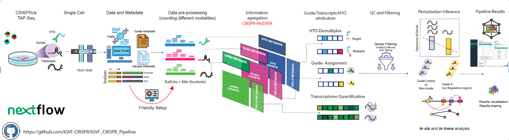

# CRISPR Pipeline

CRISPR Pipeline is a Nextflow workflow for turning raw single-cell CRISPR
screen reads into quality-controlled count matrices and perturbation results.
It supports transcriptome-wide and targeted assays with RNA, guide RNA, and
optional hashtag oligo (HTO) libraries.

**[Documentation](https://pinellolab.github.io/CRISPR_Pipeline/)** ·
**[Run v1.1.0](https://github.com/pinellolab/CRISPR_Pipeline/tree/v1.1.0)**

## What it does

- **Map and quantify** RNA, guides, and optional HTOs using SeqSpec-defined read structure.
- **Apply QC and call guides**, with optional HTO demultiplexing. Collect raw counts, annotations, and guide assignments in MuData.
- **Review QC before inference.** The default checkpoint publishes a dashboard and MuData handoff. Full runs add local SCEPTRE and PerTurbo tests and global PerTurbo tests.

## Start here

| Task | Guide |
| --- | --- |
| Install and run | [Quick start](https://pinellolab.github.io/CRISPR_Pipeline/usage/) · [Slurm setup](https://pinellolab.github.io/CRISPR_Pipeline/run-recipes/#slurm-configuration) |
| Prepare inputs | [Dataset examples](https://pinellolab.github.io/CRISPR_Pipeline/examples/) · [Basic and advanced configuration](https://pinellolab.github.io/CRISPR_Pipeline/configuration/) |
| Review results | [Dashboard](https://pinellolab.github.io/CRISPR_Pipeline/live_wandb_execution_dashboard/) · [Output files](https://pinellolab.github.io/CRISPR_Pipeline/output/) |

[GitHub Issues](https://github.com/pinellolab/CRISPR_Pipeline/issues) · [Citations](CITATIONS.md)
