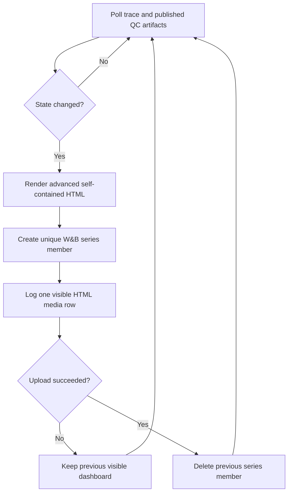

# Live W&B execution dashboard

## Completed-run execution history and plot inspection

When the recorded workflow status is completed, earlier execution errors are
retained in a separate, collapsed **Execution history & diagnostics** section
after the scientific categories. They are not presented as an active pipeline
failure. Task exceptions remain recorded; workflow completion alone does not
prove that a failed or ignored task recovered. Result-quality warnings, skipped
Scrublet sets, missing analyses and calibration caveats stay visible in their
scientific categories. Failed or interrupted workflows retain prominent failure
evidence.

In a standalone browser or GitHub Pages, click any figure to open its full-size
image. The viewer provides zoom in/out, fit-to-window, actual size, scrolling,
download, keyboard activation and Escape to close. It is self-contained and
does not load external scripts. Plot data and image resolution are unchanged;
enlarging a raster image cannot create additional detail. Embedded viewers that
strip JavaScript may not support the interactive controls.

The same viewer is built into the original static dashboard generators
(`create_dashboard.py` and `create_dashboard_HASHING.py`), including the default
and hashing Nextflow branches. Their figure buttons open the full plot, not its
SVG icon. This works without the live observer plugin or W&B wrapper. Static
reports do not establish the final Nextflow lifecycle status; completed-run
error classification requires the advanced report's recorded status and trace.

These are presentation-only changes. **Do not rerun mapping, filtering or
inference just to update the interface.** The renderer applies them to future
reports; existing advanced HTML reports can be updated while preserving the
original:

```bash
python bin/dashboard_presentation.py old_dashboard.html updated_dashboard.html
```

The temporary Pages deployment applies the same transformation to its five
report snapshots at build time; original server and Drive copies are unchanged.

For figures from actual QC, inference, and calibration results and a link to
a completed interactive dashboard, see the [result gallery](output-gallery.md).

The bundled `plugins/nf-crispr-dashboard` Nextflow observer starts the renderer
inside Nextflow, updates it as processes finish, and can serve the HTML on a
configurable local HTTP port. Enable it with `-c conf/dashboard_plugin.config`
after installing the bundled versioned archive into a shared
`NXF_PLUGINS_DIR` using `bash run_support/install_dashboard_plugin.sh`.
It remains opt-in until the same version is published and verified from a clean
Nextflow Plugin Registry cache; a fresh clone alone does not install it. See
the [plugin installation guide](plugin-installation.md) for exact commands,
site-specific storage requirements, and verification steps.

The advanced CRISPR Pipeline execution dashboard is the canonical dashboard
both locally and in W&B. `bin/run_with_wandb.sh` renders the same self-contained
HTML continuously to `pipeline_dashboard/execution_dashboard.html`. On a
completed run, it also becomes `pipeline_dashboard/dashboard.html`; the older
scientific report is retained as `pipeline_dashboard/legacy_dashboard.html`
only as an input source for final tables and figures. Do not link the legacy
report as the supported dashboard.

The wrapper remains an alternative when the plugin is not installed. It always renders the local dashboard, even without credentials.
With `WANDB_ENABLED=true` (default), `WB_IGVF` and a working W&B Python
environment additionally publish the live view online. If either is missing,
the pipeline and local HTML still work. Set `WANDB_ENABLED=false` for an
explicit local-HTML-only run. The direct `nextflow run` entry point remains
usable. With the observer config it produces the live dashboard without a wrapper;
without either observer or wrapper, only the static report is available.

## Required default behavior

Runs launched with `bin/run_with_wandb.sh` use these defaults:

- `WANDB_PUBLISH_LIVE_HTML=true`: render whenever the trace or published QC
  state changes, including while Nextflow is running;
- `WANDB_REPLACE_RUN=true`: publish one visible HTML history point in a new W&B
  run, verify that upload succeeded, and only then delete the preceding run in
  the same dashboard series;
- one stable `WANDB_RUN_ID` is a **series ID**, not a deleted/reused W&B run ID;
- every visible series member contains exactly one
  `pipeline/main_execution` media row, so no Step selector contains stale
  dashboard copies; and
- W&B remains fail-open: upload errors cannot change the Nextflow exit status
  or scientific outputs, and the same advanced HTML remains available locally.

Live refreshes share a cumulative upload budget (`WANDB_MAX_BYTES`, 400 MB by
default). The completed dashboard does not consume that live budget and is
always attempted using its own per-file allowance
(`WANDB_MAX_FINAL_HTML_BYTES`, 100 MB by default). If live refreshes exhaust
their budget, the most recent successful live view remains visible until the
reserved final update replaces it.

Nextflow appends completed tasks to `trace.tsv`; therefore the monitor also
reads bounded `TaskHandler` records from the Nextflow log to display submitted
and running tasks before they complete. A red failure-evidence panel is shown
only for a failed/aborted trace task or an explicit pipeline-error marker.
Routine debug fields such as `error: -` do not trigger it.

The newest successfully uploaded run is retained when replacement fails. This
prevents a transient network or W&B error from removing the last usable view.

## Checkpoint and continuation

A completed checkpoint is labeled **Ready for inference** and publishes a
`checkpoint_qc/` snapshot beside its manifest. The continuation dashboard
uses this snapshot for the original Mapping and QC panels and shows the
resumed inference and evaluation alongside them. The continuation header
reports the parent run and the checkpoint, submitted, and accepted cell
counts. Task status and timing describe the current invocation.

The observer and wrapper update `pipeline_dashboard/execution_dashboard.html`
while inference runs. The completed continuation is also available at
`pipeline_dashboard/dashboard.html` from a standalone Nextflow invocation.
See the [checkpoint guide](preinference_checkpoint_user_guide.md) for the handoff layout
and older checkpoint behavior.

## Pipeline flow shown in the dashboard

```mermaid
flowchart LR
    A[Input validation and preparation<br/>samples, metadata, references] --> B[Library structure QC<br/>SeqSpec and observed guide capture]
    B --> C[Library mapping<br/>GEX, guides, optional HTO and RNA saturation]
    C --> D[GEX preprocessing<br/>cell calling and per-set RNA QC]
    D --> E[MuData assembly<br/>barcode intersection]
    E --> F[Guide assignment<br/>guide-positive cells]
    F --> Q[Post-concatenation QC<br/>mitochondrial, clone and embedding QC]
    Q --> G[Inference<br/>SCEPTRE and PerTurbo]
    G --> H[Evaluation<br/>controls and benchmarks]
    H --> I[Final<br/>reports and provenance]
```



Each category panel must contain:

1. its ordered processing flow;
2. completed, cached, failed and running task state from the Nextflow trace;
3. a process/task table with runtime and recorded peak memory;
4. QC metrics and figures available at that point; and
5. bounded failure evidence when a task fails.

Process-to-category routing is implemented by `family_for()` in
`bin/render_wandb_pipeline_dashboard.py`. Reference preparation belongs to
Input validation and preparation. Library mapping includes RNA sequencing
saturation when enabled. The saturation estimate uses RNA mapping records and
the barcodes retained by RNA preprocessing. Clone removal belongs to
Post-concatenation QC. The Evaluation gallery contains downstream trans-effect
distributions and the TF benchmark when produced.

The library-structure table shows the best observed mate and orientation for
each sampled FASTQ pair. Compare that result to the supplied SeqSpec. The table
and glossary explain the hit, position and flank metrics. The mapping recovery
card reports a separate check on mapped guide support and barcode overlap,
with thresholds taken from the run's recovery report.

## Cell and gene filtering flow

```mermaid
flowchart LR
    A[Mapped RNA per measurement set] --> B[Independent barcode-rank curve]
    B --> C{QC_barcode_filter}
    C -->|knee or knee2| D[Retain cells at RNA UMI knee]
    C -->|none| D2[Retain input barcodes]
    D --> F[QC_min_counts_per_cell]
    D2 --> F
    F --> G[Two-sided RNA UMI and detected-gene MAD filters]
    G --> H[Scrublet per measurement set]
    H --> I[Intersect RNA and guide barcodes]
    I --> J[Guide assignment and assigned-guide eligibility]
    J --> K[Guide-count limits and concatenation]
    K --> L[Post-concatenation QC: mitochondrial filter]
    L --> M[Fractional gene support on the delivered cohort]
```



The dashboard links resolved analysis settings to their pipeline stages and
uses the parameter schema for descriptions, types and optionality. The RNA
stage shows the resolved barcode caller, minimum RNA UMIs and MAD multipliers.
Scrublet settings and per-set filter counts are shown only when applicable.
The filter table distinguishes step-specific removal from retention relative
to the original set and explains ties at the knee UMI threshold. Mitochondrial
and fractional gene support filtering appear after concatenation.

Every section reports only its recorded stage cohort. Preprocessing totals,
per-set tables, and cards end at RNA QC (barcode calling, UMI floor, MAD policy,
and Scrublet). They do not use final MuData cell counts or final RNA/mitochondrial
statistics. MuData shows the recorded RNA–guide intersection. Guide assignment
shows assigned-guide eligibility and min/max-guide filter counts when available;
it does not substitute final-cohort statistics for missing stage metrics.
Mitochondrial filtering is displayed in Post-concatenation QC, after Guide
assignment, with its recorded per-set before/after counts. Final RNA and guide
statistics and their plots are grouped there after the downstream filter flow.
This includes pooled RNA and guide plots made by the final report builder.
The Final dashboard stage shows a cross-stage count sequence from recorded
metrics and gives the source artifact paths. The Inference table search
operates on the displayed preview of the lowest-p-value rows.
For example, 149,074 RNA-QC cells and 24,771 final cells are distinct stage
counts, not contradictory values. Missing intermediate statistics remain
unavailable rather than being reconstructed from final cells. Completed reports
can be regenerated without rerunning inference. Existing running sources remain
pinned until a deliberate update or report-only rebuild.

## Update lifecycle



At completion, the same advanced interface is rendered with final inference
and evaluation tables and all available QC images. Completion does not switch
to a different dashboard design. It is saved under the results directory even
after the wrapper and W&B upload process exit.

## Verification

```bash
python -m pytest -q \
  tests/test_wandb_html_monitor.py \
  tests/test_wandb_pipeline_dashboard.py
```

An online two-refresh smoke test must leave exactly one run whose
`dashboard_series_id` matches the configured series. It must have one HTML
history row and one HTML media file.
