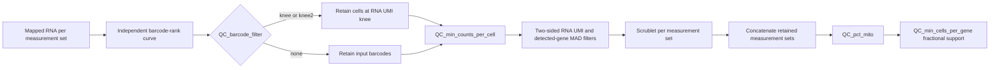
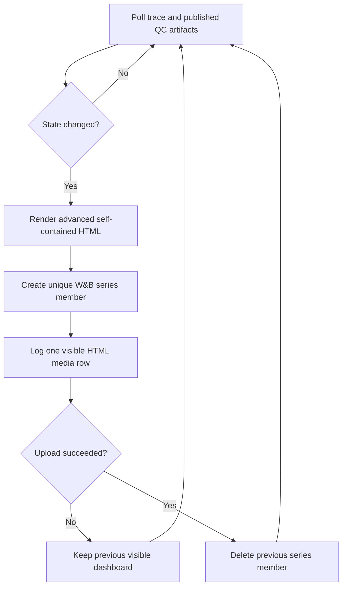

# Live W&B execution dashboard

An in-repository Nextflow observer plugin is under validation in
`plugins/nf-crispr-dashboard`. It starts this same renderer from Nextflow
itself and can serve the live HTML on a configurable local HTTP port.
`conf/dashboard_plugin.config` is opt-in until the versioned plugin has been
published to the Nextflow Plugin Registry and tested from a clean plugin
cache. Do not make an unpublished plugin mandatory in the default config:
that would prevent fresh users from starting the scientific workflow.

The advanced CRISPR Pipeline execution dashboard is the canonical dashboard
both locally and in W&B. `bin/run_with_wandb.sh` renders the same self-contained
HTML continuously to `pipeline_dashboard/execution_dashboard.html`. On a
completed run, it also becomes `pipeline_dashboard/dashboard.html`; the older
scientific report is retained as `pipeline_dashboard/legacy_dashboard.html`
only as an input source for final tables and figures. Do not link the legacy
report as the supported dashboard.

The wrapper always renders the local dashboard, even without credentials.
With `WANDB_ENABLED=true` (default), `WB_IGVF` and a working W&B Python
environment additionally publish the live view online. If either is missing,
the pipeline and local HTML still work. Set `WANDB_ENABLED=false` for an
explicit local-HTML-only run. The direct `nextflow run` entry point remains
usable, but without the wrapper it only produces the older static report as a
fallback; use the wrapper for the supported live dashboard.

## Required default behavior

Runs launched with `bin/run_with_wandb.sh` use these defaults:

- `WANDB_PUBLISH_LIVE_HTML=true`: render whenever the trace or published QC
  state changes, including while Nextflow is running;
- `WANDB_REPLACE_RUN=true`: publish one visible HTML history point in a new W&B
  run, verify that upload succeeded, and only then delete the preceding run in
  the same dashboard series;
- one stable `WANDB_RUN_ID` is a **series ID**, not a deleted/reused W&B run ID;
- every visible series member contains exactly one
  `pipeline/main_execution` media row, so no Step selector contains stale
  dashboard copies; and
- W&B remains fail-open: upload errors cannot change the Nextflow exit status
  or scientific outputs, and the same advanced HTML remains available locally.

Live refreshes share a cumulative upload budget (`WANDB_MAX_BYTES`, 400 MB by
default). The completed dashboard does not consume that live budget and is
always attempted using its own per-file allowance
(`WANDB_MAX_FINAL_HTML_BYTES`, 100 MB by default). If live refreshes exhaust
their budget, the most recent successful live view remains visible until the
reserved final update replaces it.

Nextflow appends completed tasks to `trace.tsv`; therefore the monitor also
reads bounded `TaskHandler` records from the Nextflow log to display submitted
and running tasks before they complete. A red failure-evidence panel is shown
only for a failed/aborted trace task or an explicit pipeline-error marker.
Routine debug fields such as `error: -` do not trigger it.

The newest successfully uploaded run is retained when replacement fails. This
prevents a transient network or W&B error from removing the last usable view.

## Pipeline flow shown in the dashboard

```mermaid
flowchart LR
    A[Input QC<br/>samples, metadata, references] --> B[SeqSpec<br/>read structure]
    B --> C[Mapping<br/>RNA and guide quantification]
    C --> D[Preprocessing<br/>per-set cell QC and gene filtering]
    D --> E[MuData<br/>barcode intersection and assembly]
    E --> F[Guide assignment<br/>guide-positive cells]
    F --> G[Inference<br/>SCEPTRE and PerTurbo]
    G --> H[Evaluation<br/>controls, saturation, benchmarks]
    H --> I[Final<br/>reports and provenance]
```



Each category panel must contain:

1. its ordered processing flow;
2. completed, cached, failed and running task state from the Nextflow trace;
3. a searchable process/task table with runtime and peak memory;
4. QC metrics and figures available at that point; and
5. bounded failure evidence when a task fails.

Process-to-category routing is implemented by `family_for()` in
`bin/render_wandb_pipeline_dashboard.py`. Reference preparation belongs to
Input QC even if invoked inside a preprocessing subworkflow. Sequencing
saturation and clone removal belong to Evaluation.

## Cell and gene filtering flow



The dashboard displays the resolved barcode caller, minimum RNA UMIs, two MAD
multipliers, Scrublet profile/rate, mitochondrial cutoff, and fractional gene
support. Cell calling, the RNA UMI floor, two-sided MAD rules, and Scrublet are
applied independently per measurement set. Mitochondrial and fractional gene
support filtering are applied after concatenation.

## Update lifecycle



At completion, the same advanced interface is rendered with final inference
and evaluation tables and all available QC images. Completion does not switch
to a different dashboard design. It is saved under the results directory even
after the wrapper and W&B upload process exit.

## Verification

```bash
python -m pytest -q \
  tests/test_wandb_html_monitor.py \
  tests/test_wandb_pipeline_dashboard.py
```

An online two-refresh smoke test must leave exactly one run whose
`dashboard_series_id` matches the configured series. It must have one HTML
history row and one HTML media file.
