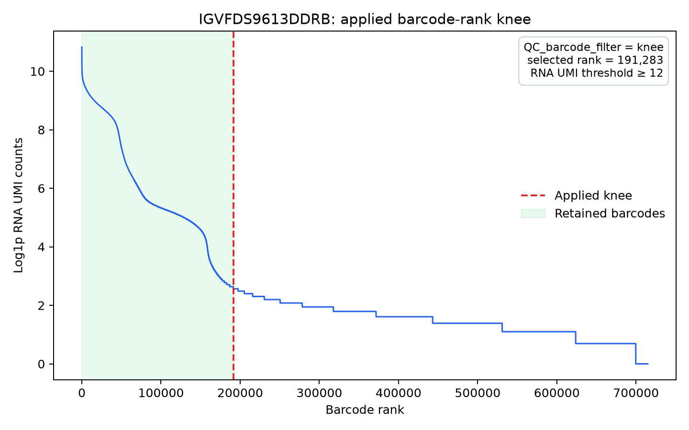
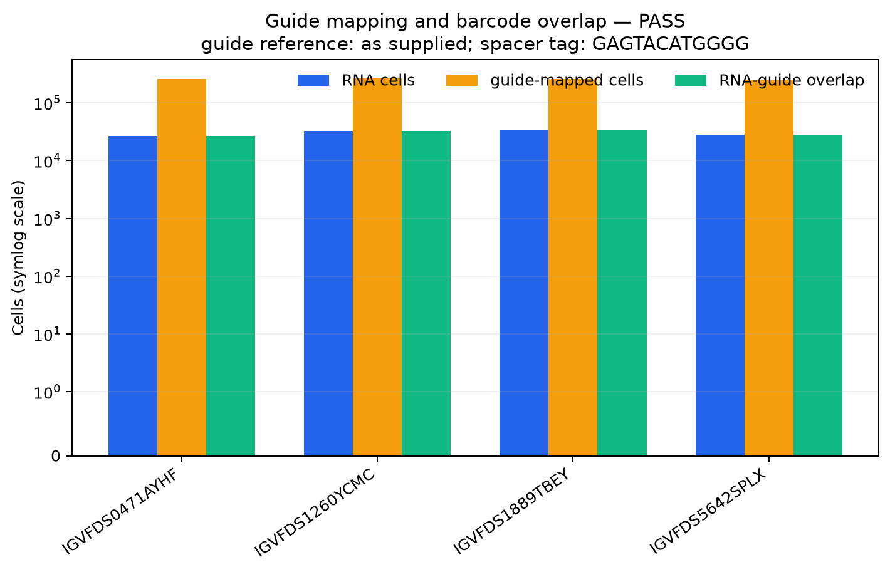
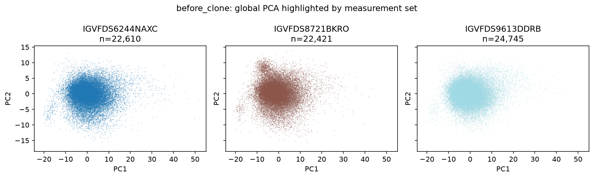
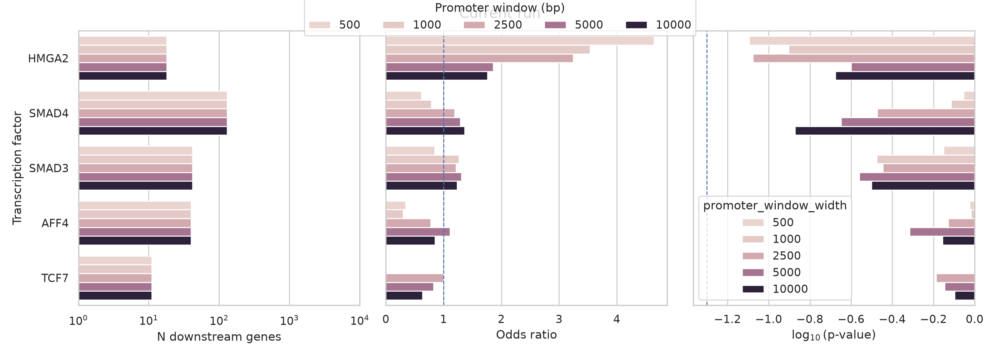
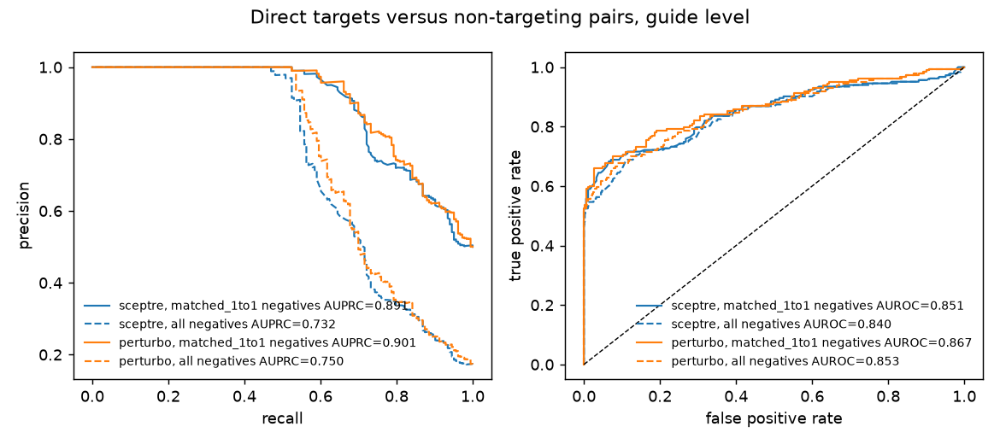

# Results and dashboard examples

These are **real outputs**, not expected values for every experiment. All five
figures come from completed 22 October 2026 benchmark runs using pipeline
commit `4aa7cc6`. Gary Hon uses
`garyhondataset_dashboard_calibration_20261022_01`; HuangFu uses
`huangfu_dashboard_calib_plugin_20261022_04`. The complete Gary Hon result
package, including its interactive dashboard, MuData, tables, QC, and
provenance, is [available on Synapse](https://www.synapse.org/Synapse:syn78349990).
The exact run configuration matters when interpreting a plot.

## Where to look in a completed run

| Question | Open | Meaning |
|---|---|---|
| What is running or failed? | `pipeline_dashboard/execution_dashboard.html` | Live/final process categories, task state, QC cards, figures, and failures. |
| Which cells and filters were used? | Dashboard **Preprocessing** and `pipeline_dashboard/figures/` | Per-measurement-set knee, sequential filter counts, and before/after plots. |
| Do guide and RNA barcodes agree? | Dashboard **Mapping / Guide assignment** and `additional_qc/guide_mapping_qc/` | Guide recovery, orientation, and RNA–guide overlap by measurement set. |
| What was tested? | Dashboard **Inference** and `pipeline_outputs/*analysis*.<ext>` | Local/cis and global/PerTurbo pair tables; absent is not the same as non-significant. |
| Are controls calibrated? | Dashboard **Inference / Evaluation** and `pipeline_outputs/calibration/` | Matched non-targeting checks when calibration is enabled and controls exist. |
| Which source/config produced it? | `pipeline_info/` | Resolved config, source commit, command, samplesheet, and execution reports. |

`<ext>` follows the selected output format; the default global PerTurbo format
is Parquet. See the [output-file reference](output.md) for the full inventory
and the [MuData reference](mudata_schema.md) for matrix fields. The dashboard
HTML is a *view* of these artifacts; use the result tables and provenance for
reanalysis. A downloaded `pipeline_dashboard.tar.gz` can be unpacked and its
`execution_dashboard.html` opened locally without W&B.

## Example: cell calling in Gary Hon

The red line is this run's selected barcode-rank knee for one measurement set,
**not** the final cell count. Later RNA, guide, HTO, and gene-support filters
can remove more cells. Inspect the per-step flow before interpreting retention.
Source: `GaryHonDataset/results_dashboard_calibration_20261022_01/pipeline_dashboard/figures/knee_plot_scRNA_IGVFDS9613DDRB.png`.

## Example: guide/RNA mapping overlap in HuangFu

Blue is RNA cells, orange is guide-mapped barcodes, and green is their
intersection. The overlap gate is evaluated on the resolved run configuration;
do not infer a universal cutoff from this figure. Source:
`HuangFuDataset/results_dashboard_calibration_20261022_04/pipeline_dashboard/additional_qc/guide_mapping_qc/guide_mapping_orientation_qc.png`.

## Example: post-concatenation PCA in Gary Hon

The plotted normalization and PCA are for QC visualization. They do not
replace the raw-count matrix used for inference. This panel helps reveal
measurement-set effects; use the scree and other QC plots before interpreting
clusters. Source:
`GaryHonDataset/results_dashboard_calibration_20261022_01/pipeline_dashboard/additional_qc/embeddings/part01/embedding_qc/pca_by_measurement_set.png`.

## Example: TF benchmark and calibration

The TF benchmark plot shows results for multiple promoter-window widths. It
is **dataset-specific** and should not be read as a general pipeline accuracy
estimate. Source:
`GaryHonDataset/results_dashboard_calibration_20261022_01/pipeline_dashboard/benchmark_output/tf_benchmark.png`.

This compares direct targets with matched non-targeting pairs for SCEPTRE
and PerTurbo. Dashed curves use all available negatives; solid curves use the
matched 1:1 negative set, so the precision-recall baselines differ. It is a
calibration/evaluation figure, **not** a test of public validated pairs.
Source:
`HuangFuDataset/results_dashboard_calibration_20261022_04/pipeline_dashboard/benchmark_output/calibration/ntc_aucpr_curves_guide.png`.

## Interactive dashboard

The bundled [Gary Hon full result package](https://www.synapse.org/Synapse:syn78349990)
contains `dashboard/pipeline_dashboard.tar.gz`. Download and unpack it, then
open `pipeline_dashboard/dashboard.html` in a browser. In this run the archive
contains that compatibility filename, whose SHA-256 matches the local
`execution_dashboard.html`; it is the same final interactive dashboard. Use the top
process-category cards to drill into measurement sets, task status, QC plots,
inference, and evaluation. The local HTML does not require W&B; online live
publication is optional. This example is a frozen completed run, whereas the
[dashboard guide](live_wandb_execution_dashboard.md) describes live updates.
